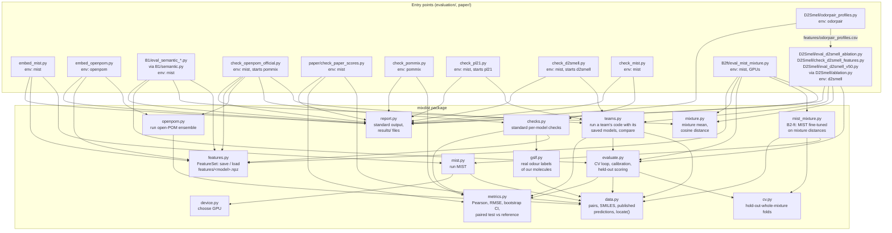
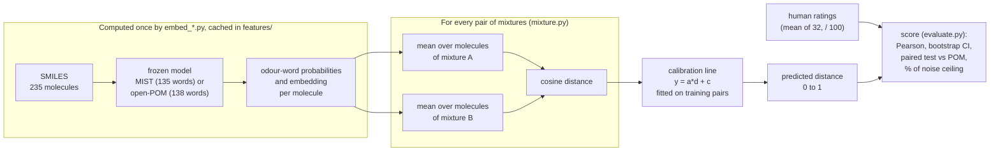
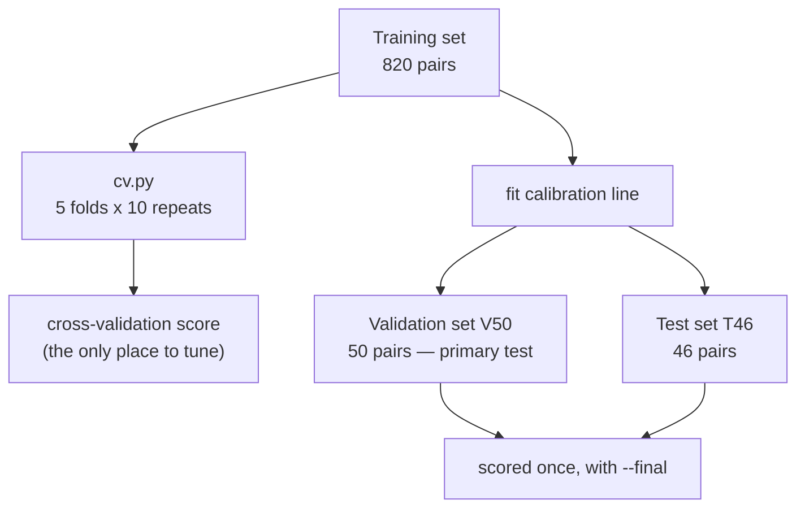

# pred_mixture — design overview

Open this file in VS Code and press `Ctrl+Shift+V` for the preview. If the diagrams show as
plain code, install the extension "Markdown Preview Mermaid Support".

## 0. Folder layout

| Folder | What it is | In git |
|---|---|---|
| `mixdist/` | our library code | yes |
| `evaluation/` | standard scripts: `embed_<model>.py`, `check_<model>.py`, checks of other teams' and the paper's code | yes |
| `evaluation/B1/` | our B1 experiment: one script per experiment (`eval_semantic_mist_odour.py`, `eval_semantic_openpom.py`, `eval_semantic_mist_odour_b1a.py`, `eval_semantic_mist_odour_b1a_cls.py`, `eval_semantic_openpom_b1a.py`, `eval_semantic_*_b1b.py`, `eval_semantic_calibration.py`), all reusing `semantic.py`. Each of our experiments gets its own subfolder; each setting its own script, no settings flags | yes |
| `evaluation/B2ft/` | B2-ft: MIST fine-tuned on mixture distances with MIST's own mixture recipe, next to frozen MIST (B1) and released POMMix: `eval_mist_mixture.py` (our split) and `eval_mist_random_split.py` (MIST's random pair split), model in `mixdist/mist_mixture.py`. Named B2-ft because PLAN.md's B2 is an embedding baseline (embeddings, mean, cosine) | yes |
| `evaluation/D2Smell/` | ablation study of team D2Smell's model: `eval_d2smell_ablation.py` (the experiment), `check_d2smell_features.py` (the layout of the team's feature row), `odorpair_profiles.py` (the team's odour-pair network run on T46 and V50 mixtures), `eval_d2smell_v50.py` (key variants scored on V50) and `ablation.py` (the variants and the rebuilt baseline, not a script) | yes |
| `training/` | training scripts, `train_<model>.py`: retraining other teams' models from scratch (PL21, D2Smell); ours later (conventions in `training/README.md`) | yes |
| `checkpoints/` | trained model weights written by `training/` (and `checkpoints/d2smell_ablation/` by `evaluation/D2Smell/eval_d2smell_v50.py`, `checkpoints/mist_mixture/` by `evaluation/B2ft/eval_mist_mixture.py`) | no |
| `tests/` | unit tests | yes |
| `paper/` | scripts that re-check the paper's published results (not our pipeline) | yes |
| `findings/` | one entry per finding: `finding_<n>.html` (page, also a Claude artifact), `finding_<n>.py` (reproduces it); index in `findings/README.md` | yes |
| `results/` | saved output of every script run (`.txt` as printed, `.json` with all numbers) | yes |
| `features/` | cached per-molecule model outputs, one `<model>.npz` per model | no |
| `external/pnas_repo/` | DREAM challenge paper: data, team models, prediction files, figure notebooks | no |
| `external/pommix_repo/` | POMMix: code, released checkpoints, datasets | no |
| `external/mist_repo/` | MIST training code (mixture recipe) | no |
| `external/chemodream_repo/` | ChemSenSim Lab code (github chemosim-lab/ChemoDREAM); no data files released | no |
| `external/m2or_repo/` | M2OR receptor–molecule database (github chemosim-lab/m2or, Apache-2.0): `M2OR_20230428.csv`, 75,050 in-vitro receptor assays | no |
| `external/ma_2021/` | INRAE binary odour mixtures (Ma et al. 2021, Etalab 2.0): per-component intensity alone and inside the mixture (masking), mixture intensity, pleasantness; 198 mixtures, 72 odorants with CID/SMILES; see its README | no |
| `external/odor_pair/` | GoodScents blender pairs (167,137) and molecules (2,985), built from the odor-pair crawl bundled with D2Smell; see its README | no |
| `../dream2_data/` | MIST model weights, `olfboost_repo/`, `PLAN.md` | separate folder |

Everything is found through `mixdist.data.locate(name)`. If the environment variable `OSMO_DATA`
points at a local copy (`~/.cache/osmo-data-mirror`), that copy and its `external/` subfolder are
used first, because the sync drive is slow (tests: 5 s from the local copy, 50 s from the sync
drive). The open-POM repo and the other teams' repos live in `~/.cache/osmo-data-mirror/external/`
(the sync drive does not allow symlinks).

## 1. Conventions

**Script names** say what the script does, by its first word:

| Prefix | Does | Writes |
|---|---|---|
| `embed_<model>.py` | runs a frozen pretrained model on every molecule (embedding + odour probabilities); no labels, no scores | `features/<model>.npz` |
| `eval_<experiment>.py` | an experiment, end to end: computes missing embeddings, then cross-validation, and with `--final` the held-out sets | `results/eval_<experiment>/` |
| `check_<thing>.py` | compares our code, our embeddings or a downloaded model with published numbers or real labels | `results/check_<thing>/` |
| `train_<model>.py` (in `training/`) | trains one of our models on the training set only; scoring is left to an `eval_` script | `checkpoints/<model>/`, `results/train_<model>/` |

Every model has the same set: `embed_<model>.py` (compute), `check_<model>.py` (check),
and `eval_<experiment>.py --model <model>` (experiment).

Tests are `tests/test_<module>.py`, one per `mixdist` module they cover. Run them all with
`python -m pytest -q tests` (mist env), or one file directly with `python tests/test_cv.py`.

**Every script** starts with a docstring giving its purpose, `Env:` (conda environment), `Usage:`
and `Writes:`, has a short `main()`, and prints through `mixdist.report.Report`. That gives the same
layout everywhere:

```
================================================================================================
eval_semantic_mist_odour   2026-11-15 15:13:14
env    mist
python /home/rein/miniforge3/envs/mist/bin/python (3.12.16)
data   /home/rein/.cache/osmo-data-mirror/pnas_repo
code   git: no commits yet
args   model=mist  final=False
================================================================================================
--- Cross-validation on the training set (5 folds x 10 repeats, ...) -----------------------------
subset                     n       r            95% CI   RMSE
all except Bushdid      2042   0.279    [0.239, 0.317]  0.129
...
saved results/eval_semantic_mist_odour/2026-11-15_151314.txt (+ .json)
```

Score tables always have the columns `n, r, 95% CI, RMSE`, plus `% ceiling`, `ref r`,
`r - ref r (95% CI)` and `p` when a noise ceiling or reference model applies. Each run is saved, so
`results/` is the record of what was run when, including every `--final` run (the script warns if
`--final` was already run for the same model).

**Array names** end in their shape, rows x columns: `probs_MxW`, `mixA_PxD`, `dist_P`. Each file
lists the letters it uses at the top (M molecules, W odour words, E embedding size, P pairs,
N pooled CV predictions, ...).

## 2. Modules and what depends on what

An arrow means "imports / uses".



`cv.py`, `metrics.py`, `mixture.py` and `report.py` import nothing heavy: the splitter only needs
objects with `a` and `b` mixtures, the others only arrays. `mist.py` and `openpom.py` import their
deep-learning libraries inside functions, so the rest of the package works in any environment.

## 3. Data flow of the B1 experiment



## 4. Which data goes where



## 5. One line per file

| File | Input | Output |
|---|---|---|
| `mixdist/data.py` | CSV files under `external/pnas_repo` | lists of `Pair` (two sets of molecule IDs + human distance), SMILES, published baseline predictions; `locate()` |
| `mixdist/cv.py` | list of `Pair` | `Fold` objects: train / test / unused pair indices, no mixture shared between train and test |
| `mixdist/mist.py` | SMILES + MIST odour weights | per-molecule probabilities, logits, embeddings (mist env) |
| `mixdist/mist_mixture.py` | MIST encoder (SMILES-pretrained base or odour model), training pairs | B2-ft. Version 1 (`fit_predict`): the whole encoder fine-tuned as MIST's mixture model (learned weighted sum, scaled cosine, 1 - R² loss), epochs by early stopping on an inner split, then retrained on all training pairs. Version 2 (`fit_predict_v2`): B1a's normalisation built in (fixed z-score per CLS dimension, length-1 mixtures, Euclidean), head started at the label mean, squared error; stage A trains weighted sum and head on the frozen encoder, stage B then unfreezes the encoder at a 10x lower lr; each stage early-stopped, raw and with a line fitted on its inner validation pairs; B1a readouts of each encoder's CLS and odour-word outputs (mist env, GPU) |
| `mixdist/openpom.py` | SMILES + open-POM checkpoints | per-molecule probabilities and embeddings, mean of 10 models; comparison with the paper's file (openpom env) |
| `mixdist/features.py` | arrays from mist.py / openpom.py | `features/<model>.npz` in one layout; `load(model)` returns a `FeatureSet` |
| `mixdist/mixture.py` | pairs + per-molecule features | mixture mean profiles, cosine distance per pair |
| `mixdist/o1.py` | embedding table, DREAM pairs, GS-LF labels, blend pairs | O1 model (receptor heads, competitive binding, distance, readouts), asymmetric loss, `Trainer` (strict / joint / pairs); tests in `tests/test_o1.py` |
| `mixdist/evaluate.py` | pairs + a `fit_predict` function | pooled CV predictions and score rows; V50 / T46 with POM reference and ceiling; `score_cv`: CV protocol of 2026-11-17 (`evaluation/CV.md`: 50 x 5, each pair once, CI by resampling mixtures) |
| `mixdist/metrics.py` | predictions, human values, optional reference model | Pearson, RMSE, 95% bootstrap interval, paired difference and p-value, bootstrap medians |
| `mixdist/pushpull.py` | any rated mixture pairs (CSV: mixture_a, mixture_b as `;`-separated molecule ids, rating, [experiment]) + molecules (id, smiles); units = Morgan fragments, SMARTS chemical classes, RDKit groups or any 0/1 table | standalone tool: per unit, its sharing effect gamma on the rating beyond each mixture's own effect and beyond overall unit overlap (pull and push of one unit are one number); general sharing effect; support and raw neither/one/both table; CI by resampling mixtures, BH q; settings no-shared / shared (units counted only on non-shared molecules) / all; optional discovery/confirmation split. CLI `python -m mixdist.pushpull`; DREAM inputs from `findings/export_pushpull_inputs.py`; tests `tests/test_pushpull.py` |
| `mixdist/report.py` | lines, tables, score dicts | standard screen output; `results/<script>/<date_time>.{txt,json}` |
| `mixdist/device.py` | free memory on each GPU | `"cuda:0"`, `"cuda:1"` or `"cpu"` |
| `mixdist/checks.py` | a model's cached features | standard checks: 1 inputs are our molecules, 2 odour outputs vs GS-LF labels (AUROC, shuffled control), 3 embedding linear probe vs GS-LF labels, 4 agreement with other models |
| `mixdist/gslf.py` | GS-LF dataset (4,983 molecules x 138 labels) | real odour labels for the 229 of our molecules it contains |
| `mixdist/teams.py` | a team's folder, the name of its conda env, the command to run | a clean working copy in `~/.cache/osmo-runs/`, the run, and its T46 predictions compared with the team's files and the paper |
| `evaluation/embed_mist.py` | MIST weights | `features/mist.npz` |
| `evaluation/embed_openpom.py` | open-POM checkpoints | `features/openpom.npz`, agreement with the paper's open-POM file |
| `evaluation/embed_mist_extra.py` | MIST odour model, GS-LF and blend-pair SMILES (Kekulized) | `features/mist_extra.npz` |
| `evaluation/embed_openpom_extra.py` | open-POM checkpoints, GS-LF and blend-pair SMILES | `features/openpom_extra.npz` (embeddings of the extra single molecules O1 trains on) |
| `evaluation/O1/eval_o1_<setting>.py` (strict, joint, pairs, strict_cal, strict_xcal, joint_xcal; `_mist` variants) | `features/openpom*.npz`, DREAM training pairs, GS-LF labels, `external/odor_pair/pairs.csv` | O1 zero-overlap CV per training-data setting, with the training log and B1a open-POM on the same folds (shared code `o1_cv.py`) |
| `evaluation/B1/semantic.py` | `features/<model>.npz` | shared B1 steps (load, CV, held-out scoring); not a script |
| `evaluation/B1/eval_semantic_mist_odour.py` | `features/mist.npz` | B1 with the MIST odour model: CV; with `--final`, V50 and T46 |
| `evaluation/B1/eval_semantic_openpom.py` | `features/openpom.npz` | B1 with the released open-POM ensemble: CV; with `--final`, V50 and T46 |
| `evaluation/B1/eval_semantic_mist_odour_b1a.py` | `features/mist.npz` | B1a: B1 MIST plus the open-POM baseline steps (`mixture.paper_distance`: quantile per word, length 1, Euclidean); B1a with open-POM = our open-POM baseline |
| `evaluation/B1/eval_semantic_mist_odour_b1a_cls.py` | `features/mist.npz` | B1a on MIST's 512-d CLS embedding (`emb`) instead of its 135 odour words (`semantic.run(..., inputs="emb")`) |
| `evaluation/B1/eval_semantic_openpom_b1a.py` | `features/openpom.npz` | B1a open-POM = our open-POM baseline (same recipe as `check_openpom_official.py`), CV; with `--final`, V50 and T46 |
| `evaluation/B1/eval_semantic_mist_odour_b1b.py`, `eval_semantic_openpom_b1b.py` | feature files | B1b: B1a with calibration scheme `overlap` (one line for pairs sharing no molecule, one for the rest) |
| `evaluation/B1/eval_semantic_calibration.py` | both feature files | CV only: shared / Bushdid / per-type calibration lines, both models |
| `evaluation/B2ft/eval_mist_mixture.py` | `mixdist/mist_mixture.py`, `features/mist.npz`, latest `check_pommix --final` run | B2-ft (two starting encoders; `--version 1|2`, saved rows of the other version shown too), its B1a readouts and B1a MIST as changes from B1 MIST on the same pairs: CV (5 folds x 3 repeats); `--cv-only` stops there; with `--final`, T46 and V50; POMMix released on T46 and V50; models in `checkpoints/mist_mixture/[v2/]` |
| `evaluation/B2ft/eval_mist_random_split.py` | `mixdist/mist_mixture.py`, `features/mist.npz` | B2-ft v2 (odour encoder) on MIST's split type: random 10% of the training pairs as test, per split; B1 MIST and B1a CLS frozen on the same pairs; test pairs split into both mixtures seen in training vs not; per-epoch log in `checkpoints/mist_mixture/random_split/` |
| `evaluation/check_mist.py` | `features/mist.npz` + GS-LF labels | standard checks (below) for MIST |
| `training/train_pl21.py` | team PL21's notebook with TRAINING = True (conda env `pl21`) | its 21 single-molecule models retrained from scratch, T46 predictions vs the team's saved models and SI Table S4 |
| `training/train_d2smell.py` | team D2Smell's training script per seed, then its ensemble step (conda env `d2smell`, GPU, ~1 h per seed) | retrained XGBoost ensembles, T46 predictions vs the team's saved models and SI Table S4 |
| `paper/check_paper_scores.py` | published prediction files | our scores next to the paper's SI Table S4 |
| `evaluation/check_pommix.py` | POMMix released checkpoints | their saved fold results reproduced here; memory and speed of training steps; the 5 checkpoints and their mean on T46 as released (no paper number to compare); with `--final`, the same on V50 |
| `evaluation/check_pl21.py` | team PL21's notebook and its 21 saved models (conda env `pl21`) | its T46 predictions rerun here, next to the team's files and SI Table S4; testing only |
| `evaluation/check_baselines.py` | latest saved runs of `check_d2smell`, `check_pl21`, `check_openpom_official`, `check_pommix` and the B1 `eval_semantic_*` scripts (`--final`) | one table per held-out set (V50, T46) of every model we ran: RMSE, r, bias, RMSE without bias, what each was trained on; mean labels by set, overlap and measurement type; rescores nothing |
| `evaluation/check_openpom_official.py` | the paper's open-POM baseline notebook (`pnas_repo/SOTA/2-openPOM`, run in env `pommix`) + `features/openpom.npz` | the paper's POM baseline on T46 rerun twice, with the paper's open-POM file and with our downloaded open-POM, all 8 variants, next to SI Table S4; our open-POM outputs vs the paper's file |
| `evaluation/check_d2smell.py` | team D2Smell's ensemble step and its 10 saved models (conda env `d2smell`) | its T46 predictions rerun here, next to the team's files and SI Table S4; testing only |
| `evaluation/D2Smell/ablation.py` | team D2Smell's data files, feature code (imported) and saved models | the team's training matrix rebuilt and checked against its saved models; the ablation variants (columns, augmentation, quantile transform, words, tuning, no XGBoost); cross-validation and T46 predictions per variant, one worker per GPU; not a script |
| `evaluation/D2Smell/eval_d2smell_ablation.py` | the variants of `ablation.py` (conda env `d2smell`, GPUs) | every variant next to the full model: cross-validation on the team's 780 training pairs (whole mixtures held out); with `--final`, T46 trained as the team did |
| `evaluation/D2Smell/odorpair_profiles.py` | the team's odour-pair network `model_33.pt` and its notebook's pair loop (conda env `odorpair` = clone of `pommix` + ogb) | 33-word odour profiles of the T46 mixtures (checked against the team's file) and the V50 mixtures, `features/odorpair_profiles.csv`; no labels |
| `evaluation/D2Smell/eval_d2smell_v50.py` | `ablation.py` + `features/odorpair_profiles.csv` (conda env `d2smell`, GPU) | full model, odour only, identity only, no quantile transform (10 seeds each, saved to `checkpoints/d2smell_ablation/`) and B1a on the network profiles; our full model vs the team's published V50 predictions; with `--final`, V50 as changes from the full model next to the T46 changes |
| `evaluation/D2Smell/check_d2smell_features.py` | the team's matrix as built by `ablation.py` (conda env `d2smell`) | the layout of the 8,182 columns XGBoost gets, checked on every training and T46 row: column ranges, each ratings column = one identity column times a fixed number, which molecules the identity columns mark, the odour words kept; no labels |
