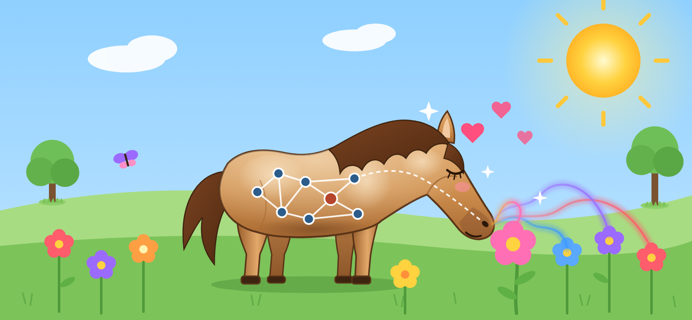
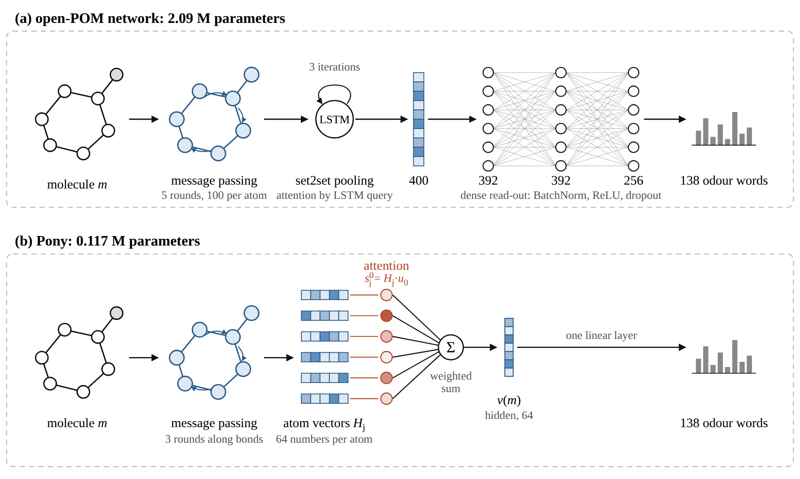
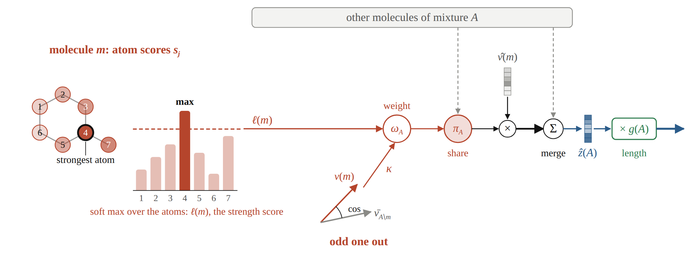

# Structure over Scale: Mixing Odours in a Pony Network like the Human Receptors

<p align="center"></p>

Code, trained model and experiments for the paper **"Structure over Scale: Mixing Odours in a Pony Network like the Human Receptors"** ([blog post](https://ywu36.github.io/posts/2026/11/structure-over-scale/)).

By [Rein (Yuhang) Wu](https://ywu36.github.io/posts/2026/11/structure-over-scale/)

Pony is a small graph neural network that predicts how different two odour mixtures smell, on the 0
(indistinguishable) to 1 (maximally different) scale of the DREAM olfactory mixtures challenge. It is trained on single
molecules, and only its mixture layer is fitted on DREAM.

| Model (Pearson r) | T46 | V50 | CV |
|---|---|---|---|
| open-POM, molecules averaged (DREAM baseline) | 0.432 | 0.552 | 0.392 |
| MIST, molecules averaged | 0.407 | 0.547 | 0.386 |
| D2Smell (DREAM team) | 0.469 | 0.165 | — |
| PL21 (DREAM team) | 0.346 | 0.071 | — |
| POMMix | 0.397 | 0.478 | — |
| open-POM + both factors (Session 1 of the paper) | 0.444 | 0.584 | 0.434 |
| **Pony** | **0.593** | **0.622** | **0.464** |

T46 and V50 are the challenge's external test sets (46 and 50 pairs). CV is 50 repeats of 5-fold cross-validation with
whole mixtures held out, on 514 development pairs.

## How Pony works

### Stage 1: a small network for single molecules

A graph neural network reads a molecule's atoms and bonds and predicts 138 odour words. It has 116,603 parameters, 18
times fewer than open-POM. Three rounds of message passing give each atom a state; attention over the atoms scores which
atoms decide the odour and pools them into a 64-unit hidden vector v(m), the molecule's receptor-like code; one linear
layer reads the words. The network is trained on single molecules only and then frozen. Code:
[pony/network.py](pony/network.py), training: [pony/train.py](pony/train.py).



*Stage 1. (a) open-POM, for comparison. (b) Pony: message passing, attention over atoms (red), the hidden vector v(m),
one linear layer to the odour words.*

### Stage 2: mixing in the hidden layer

A mixture becomes one point in the same 64-unit hidden layer. Each molecule gets a weight from its strongest atoms
(soft maximum of its atom scores) and from how much it stands out from the other molecules (odd one out). The weights
become shares, the molecules' hidden directions are summed by share, and a learned length scales the result. The
predicted rating is a straight line in the distance between the two mixtures' points:
rating(A, B) = a |point(A) − point(B)| + c. Only 133 numbers per network copy are fitted on the 820 rated DREAM pairs;
predictions average 10 copies. Code: [pony/readout.py](pony/readout.py).



*Stage 2. How one molecule m enters mixture A: the soft maximum of its atom scores gives its strength ℓ(m); with
the odd-one-out term (cosine to the mean of the other molecules, weight κ) this gives its weight, normalized into a
share π_A(m); shares scale the molecule directions, which are summed into the mixture direction ẑ(A) and scaled by the
learned length g(A).*

## Install

```bash
pip install -e .            # numpy, torch, rdkit
pip install -e ".[test]"    # + pytest
```

## Use the trained model

The paper's model ships with the package ([pony/weights/pony_dream.pt](pony/weights/pony_dream.pt)); it needs no data
and runs on the CPU. A mixture is a list of SMILES.

```python
import numpy as np
from pony import Pony

model = Pony.from_pretrained()          # the paper's model: 10 copies, readout fitted on the DREAM training pairs

fruity  = ["CC(C)CCOC(C)=O", "CCCC(=O)OCC", "CCCCCCOC(C)=O"]               # isoamyl acetate, ethyl butyrate, hexyl acetate
vanilla = fruity + ["COc1cc(C=O)ccc1O"]                                     # the same three + vanillin

model.predict([fruity], [vanilla])      # one pair -> one rating
# -> [0.523]
```

What `predict` does inside, step by step: each mixture becomes a point in the hidden layer, and the rating is a line in
the distance between the two points (per copy, then averaged over the 10 copies).

```python
points = model.embed([fruity, vanilla])           # copies x mixtures x 64
a, c = model.line().T                             # each copy's line
distance = np.linalg.norm(points[:, 0] - points[:, 1], axis=1)
(a * distance + c).mean()                         # -> 0.523, the same as predict
```

Many pairs at once: `predict(list_a, list_b)` compares `list_a[i]` with `list_b[i]` and returns one rating per pair.

```python
citrus = ["CC1=CCC(CC1)C(C)=C", "CC(C)=CCCC(C)=CC=O", "CC(C)=CCCC(C)(O)C=C"]  # limonene, citral, linalool
smoky  = ["COc1ccccc1O", "Oc1ccccc1", "c1ccc2[nH]ccc2c1"]                  # guaiacol, phenol, indole

model.predict([fruity, fruity,  fruity, fruity],
              [fruity, vanilla, citrus, smoky])
```

| pair | predicted rating |
|---|---|
| fruity vs fruity (identical) | 0.334 |
| fruity vs fruity + vanillin | 0.523 |
| fruity vs citrus | 0.688 |
| fruity vs smoky | 0.732 |

`model.explain(mixture)` shows each molecule's share of a mixture: in `vanilla`, vanillin takes 0.45 and each fruity
ester about 0.18–0.19.

The fitted line maps a zero distance to about 0.33, so identical mixtures get 0.33, not 0: people rarely rate a pair
near 0 (only 1% of DREAM training pairs are below 0.2). Compare predictions with each other rather than with 0. Any
molecule RDKit can parse is accepted; molecules need not be in the DREAM data.

## Train Pony on your own data

Training follows the two stages of the figure at the top.

| Stage | What it learns | Data it needs | Time (paper's data) |
|---|---|---|---|
| 1. network | 116,603 parameters per copy, then frozen | single molecules labelled with odour words | about 25 s per copy on a desktop GPU |
| 2. mixture readout | 133 numbers per copy | rated mixture pairs | about 16 s for 10 copies on a CPU |

If you only have rated mixture pairs, skip steps 3 and 4 and start from the paper's networks with
`model = Pony.from_pretrained()`.

The whole path below is also a ready-to-run script, [examples/train_pony.py](examples/train_pony.py):

```bash
python examples/train_pony.py --molecules molecules.csv --pairs pairs.csv --out my_pony.pt
python examples/train_pony.py --pairs pairs.csv --out my_pony.pt        # Stage 2 only, on the paper's networks
```

**Step 1. Prepare two files.**

`molecules.csv` (Stage 1): a SMILES column and one 0/1 column per odour word; other columns are ignored. open-POM's
curated GS-LF file (`curated_GS_LF_merged_4983.csv`, SMILES column `nonStereoSMILES`, 138 words) has this format and is
what the paper used.

```
smiles,fruity,green,sweet,...
CCOC(C)=O,1,0,1,...
```

`pairs.csv` (Stage 2): one rated pair per row; a mixture is its SMILES joined by `;`; ratings on any scale (the fitted
line adapts). The row below shows the format only; its rating is a placeholder.

```
mixture_a,mixture_b,rating
CCO;CC(=O)OCC;CC(C)=O;CCCCO,CC(C)CO;CCOC(C)=O;CC=O;CCCC(=O)O,0.5
```

**Step 2. Load them.**

```python
import numpy as np
from pony import Pony
from pony.data import read_molecules, read_pairs, holdout_mixtures, subset
from pony.train import train_network

smiles, labels, words = read_molecules("molecules.csv", smiles_column="smiles")   # labels: molecules x words, 0/1
mix_a, mix_b, y = read_pairs("pairs.csv")                                         # lists of SMILES lists, ratings
```

**Step 3. Stage 1: train the network copies** on single molecules, with open-POM's recipe (62 epochs, batch 128, Adam,
learning rate 0.001 halved every 640 steps, L1 + L2 weight penalty). The copies differ only by their seed.

```python
nets = [train_network(smiles, labels, seed=s, device="cuda") for s in range(10)]   # device="cpu" also works, slower
```

**Step 4. Freeze them into a model.** This computes two constants per copy: the hidden scale (from the training
molecules) and the network's own atom scorer (from the molecules your mixtures use).

```python
reference = sorted({s for m in mix_a + mix_b for s in m})   # every molecule in your mixture pairs
model = Pony.from_networks(nets, words, smiles, reference)
```

**Step 5. Hold out whole mixtures for checking.** Every pair that contains a held-out mixture goes to the test set, so
the fit never sees a test mixture.

```python
test = holdout_mixtures(mix_a, mix_b, fraction=0.2, seed=0); train = ~test
```

**Step 6. Stage 2: fit the mixture readout** (133 numbers per copy; the networks stay frozen).

```python
model.fit(subset(mix_a, train), subset(mix_b, train), y[train])
```

**Step 7. Check on the held-out pairs.**

```python
pred = model.predict(subset(mix_a, test), subset(mix_b, test))
print("r", np.corrcoef(pred, y[test])[0, 1], "RMSE", np.sqrt(np.mean((pred - y[test]) ** 2)))
```

**Step 8. Refit on all pairs, save, and load later.**

```python
model.fit(mix_a, mix_b, y)
model.save("my_pony.pt")
model = Pony.from_pretrained("my_pony.pt")        # used exactly like the paper's model
```

### Rebuild the paper's model exactly

[reproduce/REPRODUCE.md](reproduce/REPRODUCE.md) lists the commands: export the GS-LF and DREAM graphs
([evaluation/O2/export_o2_graphs.py](evaluation/O2/export_o2_graphs.py)), train the 10 copies with the research script
([training/train_o3m.py](training/train_o3m.py) `--config attpool --seeds 0 1 2 3 4 5 6 7 8 9`), and build and check the
shipped weights ([reproduce/build_pony_weights.py](reproduce/build_pony_weights.py), which asserts T46 0.593 and V50
0.622).

## Repository layout

| Folder | Contents |
|---|---|
| [pony/](pony/) | the model as a package: featurizer ([features.py](pony/features.py), open-POM's atom and bond features in plain RDKit), network ([network.py](pony/network.py)), Stage-1 training ([train.py](pony/train.py)), mixture readout ([readout.py](pony/readout.py)), file readers ([data.py](pony/data.py)), `Pony` class ([model.py](pony/model.py)), shipped weights ([weights/pony_dream.pt](pony/weights/pony_dream.pt)) |
| [reproduce/](reproduce/) | [build_pony_weights.py](reproduce/build_pony_weights.py) (builds the shipped weights and checks them against the research pipeline) and [REPRODUCE.md](reproduce/REPRODUCE.md) (which script produces each table of the paper) |
| [mixdist/](mixdist/) | research library: DREAM data loading and cleaning, mixture-holdout cross-validation, metrics with bootstrap intervals, open-POM and MIST runners, baselines |
| [training/](training/) | research Stage-1 training scripts and retraining of other teams' models |
| [evaluation/](evaluation/) | every experiment of the project, one script per experiment (see [evaluation/README.md](evaluation/README.md)) |
| [paper/](paper/) | re-checks of the DREAM paper's published scores |
| [tests/](tests/) | unit tests (`pytest`) |
| [examples/](examples/) | [train_pony.py](examples/train_pony.py): training from files to a saved model |
| [docs/figures/](docs/figures/) | the three diagrams above (SVG sources and PNG) |
| [design/](design/) | design notes written during development |

[ARCHITECTURE.md](ARCHITECTURE.md) describes the research code's conventions (script prefixes, the `Report` output
format, how data folders are found).

## Data

The trained model needs no data. Reproducing the experiments needs:

* the DREAM olfactory mixtures challenge repository (training pairs, T46, V50, molecule SMILES), placed in
  `external/pnas_repo/` or in a folder named by the environment variable `OSMO_DATA`;
* open-POM's curated single-molecule odour data (GS-LF) for Stage-1 training, exported by
  [evaluation/O2/export_o2_graphs.py](evaluation/O2/export_o2_graphs.py) to `features/o2_graphs.npz`.

`mixdist.data.locate` explains the search order.

This repository contains no third-party data or code. The scripts read datasets, baseline models and other teams'
code from your own downloads (`external/`), and each keeps its own license and terms of use. Two scripts use classes
from other projects and load them from those downloads at run time:
[mixdist/mist_mixture.py](mixdist/mist_mixture.py) (MIST) and
[evaluation/D2Smell/odorpair_profiles.py](evaluation/D2Smell/odorpair_profiles.py) (team D2Smell and odor-pair).
The shipped Pony weights were trained on GS-LF and the DREAM training pairs; check those datasets' terms before
commercial use.

## Tests

```bash
pytest -q tests                  # all tests
pytest -q tests/test_pony.py     # the packaged model and its training code
```

Tests that need the DREAM data (including the check that the shipped model reproduces T46 0.593 and V50 0.622) are
skipped when it is not available.

## License

MIT, see [LICENSE](LICENSE). Copyright (c) 2026 Rein (Yuhang) Wu.
